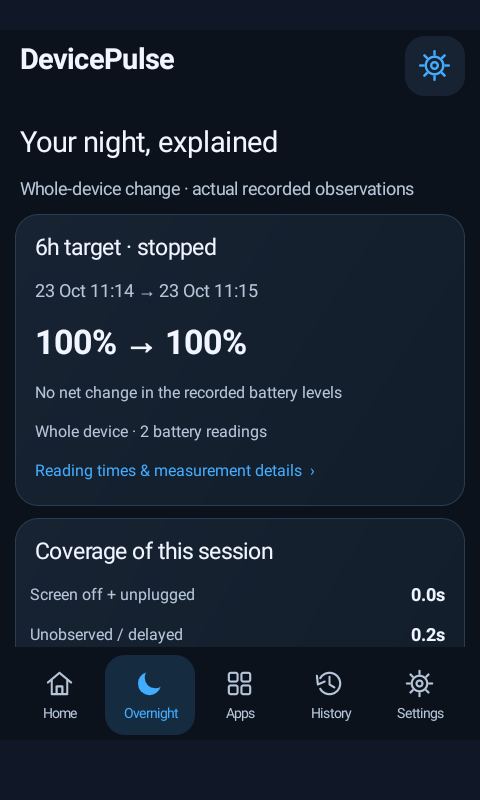
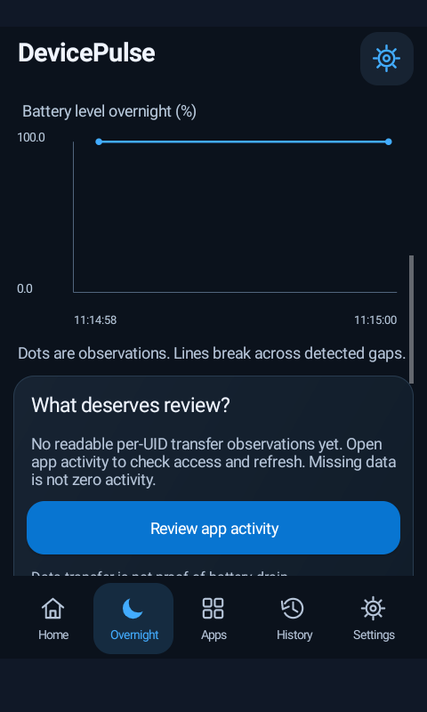
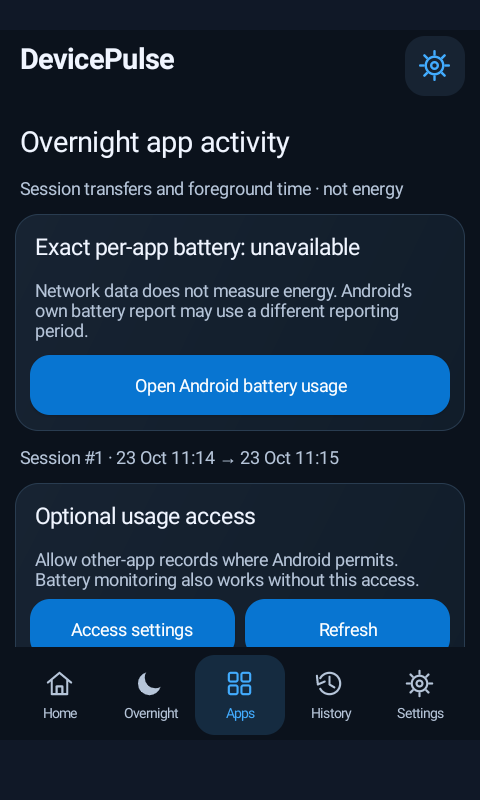

# DevicePulse 1.1.0 — overnight battery report

[Download debug APK](https://raw.githubusercontent.com/sduos4029-CODE/App_monitor/devicepulse/overnight-ui/delivery/DevicePulse-1.1.0-debug.apk) · [Complete source ZIP](https://raw.githubusercontent.com/sduos4029-CODE/App_monitor/devicepulse/overnight-ui/delivery/DevicePulse-1.1.0-source.zip) · [Executed verification](docs/VALIDATION-v1.1.0.md)

A native Android app focused on **what happened while your phone was unused overnight**. Package `dev.devicepulse`, Android 8/API 26+, versionCode 2. Updates the matching-signed 1.0.0 app without deleting its local history or preferences. The original repository's `Nightwatch.apk` (`dev.nightwatch`) remains unchanged and separate.

## Use it tonight

1. Open Home and start a **6h or 7h target** before bed.
2. Unplug the phone and turn its screen off. No wake lock, exact alarm or continuous sensor subscriptions are used.
3. In the morning, open Overnight: inspect actual battery endpoints, loss/gain, observed screen-off/unplugged time, other observed intervals, unobserved time and the timeline.
4. Open Apps for permitted network/foreground records. Optional Usage access is requested only through the feature's settings button. Add a reason only if you can confirm it from the app's settings/logs or your own activity.
5. Use Android Battery usage for Android's own energy report. Its time range may differ from this session. DevicePulse opens that screen; it cannot read its private figures.

**Network traffic does not prove battery drain.** Ordinary apps cannot access reliable per-app energy/CPU/wake-lock accounting or private job purposes. Sync, backup, update/download and alarm are possible explanations, never automatically detected causes. Authorized privileged imports remain separately labelled and excluded from real alerts/rankings.

Android can delay or terminate collection during sleep. A 6h/7h target does not guarantee uninterrupted coverage or an exact stop alarm. Version 1.1 keeps the actual final sample/end time and records a target overrun rather than backdating a late reading. Missing time stays unknown. One timed battery reading cannot establish a zero loss; clock discontinuities make rates/coverage unreliable. Screen off is not proof that nobody touched the phone.

## Screens and retained tools

Five bottom tabs: **Home, Overnight, Apps, History, Settings**. Native vector icons, compact rounded cards, blue controls and dark/light mode; the app does not embed generated demo images or example measurements.

History retains timelines, 7/30-day comparisons, CSV/JSON/PDF document-picker exports and optional sharing, plus validated collector imports. Settings keeps components (battery/thermal state, CPU identifiers/accessible frequency, sensor inventory and optional 15-second readings, radios, RAM/storage/display/audio and other exposed states), recurring findings and searchable logs. Unsupported/restricted/permission-required/unavailable readings stay labelled. No per-app metrics are substituted with zero.

No Internet permission, ads, analytics, tracking libraries, root, accessibility service or broad storage permission. History is local with deletion controls; exported documents remain under the user's control. Battery temperature alerts occur only when a sample is received; they are not continuous thermal protection.

## Actual native screenshots

These are PixelCopy captures from a running Android 11 emulator with a short stopped session using actual API observations. They are **not** completed overnight measurements or physical-device validation. System overlays/chrome are excluded. Scroll within the app to see full reports.







## Reproducible build and tests

Install JDK 17+ (tested Temurin **21.0.8+9**), Android SDK command-line tools, `platforms;android-35`, `build-tools;35.0.0` and `platform-tools`; accept SDK licenses. Set `JAVA_HOME`, add its `bin` to PATH, and set `ANDROID_HOME`. Gradle **8.10.2** is pinned with its distribution SHA-256; Android Gradle plugin **8.7.3**. Keep TLS verification enabled and configure approved proxy/CA trust as needed.

```sh
./scripts/build.sh
# app/build/outputs/apk/debug/app-debug.apk

# DISPOSABLE emulator only: erases DevicePulse test history.
./scripts/test-emulator.sh

# Optional native app-window captures; also clears disposable test data:
adb shell am instrument -w -r -e capturesOnly true dev.devicepulse.test/dev.devicepulse.PulseTests
```

**Debug signed**, not release/Play signed. The signing key stays outside this repository and ZIP. A new developer's independently generated debug key cannot update this published APK; retain the original private key securely for future matching updates. Never silently uninstall to bypass a signature mismatch. Keep Play Protect enabled; no installation approval is promised.

Build/lint, **16 host assertions, 23 Android instrumentation tests**, a same-signature 1.0→1.1 update-retention test and report roundtrips were executed. No full 6h/7h endurance run or physical battery-overhead benchmark was performed. Physical Doze/OEM behavior, radios/sensors, Android 13+ prompts and Android 14+ foreground-service behavior still require phone testing. Full picker/share/import UI interactions are not yet automated end to end. Details and actual logs: [verification](docs/VALIDATION-v1.1.0.md).

[Measurement definitions](docs/MEASUREMENTS.md) · [Collector import format](docs/IMPORTS.md) · [Illustrative import JSON](examples/privileged-import.json) · [Original 1.0 verification](docs/VALIDATION.md)
