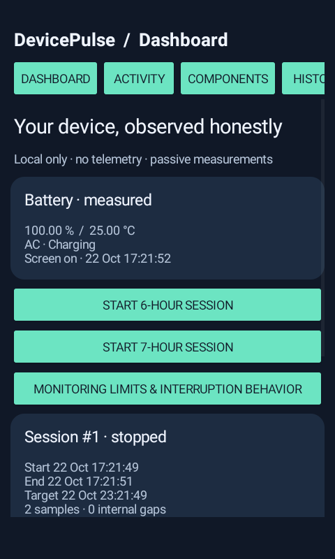
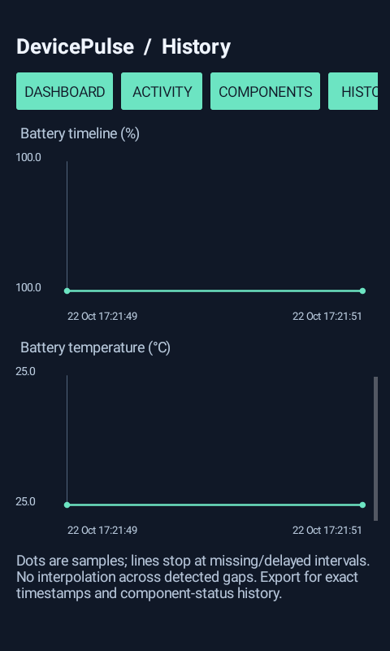

# DevicePulse 1.0.0

[Download debug APK](https://raw.githubusercontent.com/sduos4029-CODE/App_monitor/devicepulse/native-monitor/delivery/DevicePulse-1.0.0-debug.apk) · [Complete source ZIP](https://raw.githubusercontent.com/sduos4029-CODE/App_monitor/devicepulse/native-monitor/delivery/DevicePulse-1.0.0-source.zip) · [Validation](docs/VALIDATION.md)

A complete, dependency-free native Java Android diagnostic app. Package **`dev.devicepulse`**, Android 8.0/API 26+, compile/target API 35. This repository originally contained only `Nightwatch.apk`; that original file is preserved unchanged. DevicePulse is a separate installation and does not alter Nightwatch's data.

## What works

- User-started **6-hour or 7-hour target windows**, foreground service with Stop notification, configurable 1/5/15-minute passive sampling (5-minute default). SQLite stores battery level, battery temperature, charging, interactive-screen and available component readings. No wake lock, exact alarm, continuous sensor polling or network uploads.
- Real sample timestamps, elapsed clock, screen/power event samples, detected sampling gaps, interruption/reboot records, full-span and screen-off/unplugged summaries. Doze can defer sampling and completion: target duration is not guaranteed coverage. Unknown intervals stay unknown.
- App/UID activity sorted by permitted network bytes or foreground duration. Optional user-controlled usage access; Android aggregate buckets may extend outside a session or be delayed. Shared/system UIDs and restricted data are labelled. Per-app energy/CPU/wake-lock remain unavailable unless separately imported. User-confirmed context: sync, backup, update, alarm or user activity.
- Component dashboard: battery/thermal status, CPU identifiers/architecture/core count/accessible frequency, app-process CPU, RAM/storage, brightness setting/refresh rate, radio and service states, sensor inventory and explicit 15-second optional live readings. Camera/mic hardware availability is distinct from use by other apps. Permission/unsupported/restricted states are explicit.
- Battery/temperature timelines, top-UID graph, searchable event and component history, 7/30-day comparisons, configurable temperature/drain/transfer thresholds, repeated completed-session findings. Findings are review prompts, never a malware verdict. Whole-device drain rates are derived estimates and not per-app attribution.
- Dark/light mode, scrollable small-phone layouts, scalable system text and graph accessibility descriptions. Local deletion; no ads, analytics, tracking SDKs or INTERNET permission.
- CSV, JSON and paginated PDF through Android's document picker, followed by an optional Android share sheet. Missing values stay `null`/`UNAVAILABLE`, never zero. Explicitly confirmed and validated privileged imports remain separate from rankings, alerts and measured history summaries.

## Build reproducibly

Install JDK 17+ (tested Temurin **21.0.8+9**), Android SDK command-line tools, `platforms;android-35`, `build-tools;35.0.0` and `platform-tools`. Accept SDK licences with `sdkmanager --licenses`. Set `JAVA_HOME`, `ANDROID_HOME`, and add `$JAVA_HOME/bin` to PATH. Gradle **8.10.2** is pinned with its distribution SHA-256 in the wrapper; Android Gradle plugin **8.7.3**. TLS verification remains enabled. In managed networks, configure the approved proxy/CA trust for the JDK; do not disable validation.

```sh
./scripts/build.sh
# Output: app/build/outputs/apk/debug/app-debug.apk
```

No signing secrets are in this repository. The default Android debug key is generated in the builder's private Android configuration directory. This is a **debug-signed testing build**, not a release/Play build. Save that private key outside source control if future debug updates must match; otherwise Android will reject an update signed with a different certificate. Never uninstall a user's app to silently resolve a signature mismatch. Production publishing would require a separately managed release key and review of the `specialUse` foreground-service declaration.

## Tests and real-device limits

```sh
./scripts/test-host.sh
# DISPOSABLE emulator only — deletes DevicePulse local test history:
./scripts/test-emulator.sh
# Optional: recapture native app windows using real short-session API samples:
adb shell am instrument -w -r -e capturesOnly true dev.devicepulse.test/dev.devicepulse.PulseTests
```

[Validation and exact executed results](docs/VALIDATION.md) documents what ran, screenshots and what remains unverified. Functional tests are short: no full 6/7-hour battery endurance result is claimed. Physical-device Doze/vendor task killers, reboot delivery, thermal accuracy, Bluetooth/SSID restrictions, sensor behavior and battery overhead require device tests. The emulator cannot verify physical power/current, real temperatures or radio conditions. No Play Protect approval is implied; keep it enabled.

## Permissions, measurements and reports

[Platform limitations and data model](docs/MEASUREMENTS.md) · [Privileged import format](docs/IMPORTS.md). Sensitive permissions are requested only for their feature. Usage access is a Settings app-op, not a normal runtime permission. Bluetooth details may need Nearby devices; Wi-Fi SSID may need location permission and enabled location services. No coordinates, background location, root, private database access or accessibility service is used.

Reports contain local component/app metadata: choose recipients carefully. Deleting app history does not delete exported documents. The application requests no Internet access and stores history locally. No demonstration mode is included; synthetic test fixtures are removed and are never retained as user history.

## Actual native app-window captures

Captured from the running Android 11 emulator using PixelCopy (system overlays excluded). Values are real emulator API observations from a short stopped session, not physical-device or overnight evidence.




